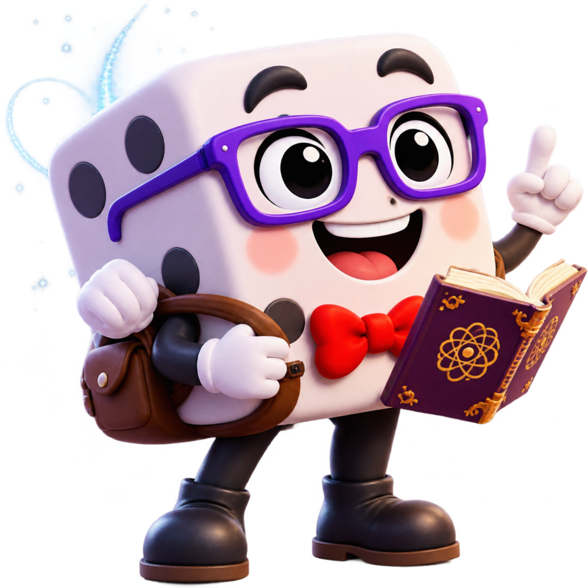

 

  

<h1 align="center">🧠 NeuroMind — Aventura pelo Mundo do Conhecimento</h1>

  
  
  
  

## 🧠 Sobre o projeto

**NeuroMind** é um jogo educativo de aventura desenvolvido para transformar o aprendizado em uma experiência interativa, explorando conceitos de lógica, probabilidade e estatística.

O jogador embarca em uma jornada pelo mundo do conhecimento, enfrentando desafios e enigmas para restaurar as sinapses e recuperar a fonte mágica.

Durante a aventura, o jogador conta com a companhia de **Sinap**, um personagem-guia que oferece orientações, apresenta os desafios e auxilia na compreensão dos conteúdos.

O projeto foi desenvolvido em equipe no contexto do Projeto de Aprendizagem Cooperativa (PAC III), do curso de Engenharia de Software.

## 🎯 Objetivo educacional

O NeuroMind busca estimular:

- Raciocínio lógico e resolução de problemas;
- Compreensão de conceitos de probabilidade;
- Interpretação de dados e informações estatísticas;
- Análise de resultados e comparação de possibilidades;
- Aprendizagem por experimentação e tomada de decisões.

## 🗺️ A jornada

A aventura é organizada em fases, com desafios progressivos que integram narrativa e aprendizagem.

### Fase 1 — Restaurando as Sinapses

A missão inicial é restaurar a fonte mágica e recuperar as sinapses por meio de quatro desafios. O jogador precisa resolver os enigmas apresentados para avançar na jornada e reconstruir o conhecimento perdido.

### Fase 2 — Floresta dos Padrões

Nesta etapa, o jogador explora conceitos de probabilidade e estatística por meio de experimentos com dados.

Um dos desafios é o **Altar dos Lançamentos**, no qual o jogador realiza lançamentos de um dado, registra resultados, observa frequências absolutas e relativas e interpreta gráficos.

## 🧠 Personagem-guia — Sinap

**Sinap** acompanha o jogador durante a aventura, oferecendo orientações e comentários para tornar a experiência de aprendizagem mais intuitiva e envolvente.

## 🛠️ Tecnologias utilizadas

- **Godot Engine 4.6:** desenvolvimento do jogo;
- **GDScript:** programação das mecânicas e funcionalidades;
- **Git e GitHub:** controle de versão e colaboração;
- **GitHub Actions:** automação e validação do projeto;
- **HTML5:** exportação para execução em navegador.

## 🎮 Jogar e baixar

**Versão Web:** [Acessar o NeuroMind](https://jenifer-lee2.github.io/DiceMind_Pac/)

**Versão Windows:** disponível para download na página de Releases.

[📦 Baixar NeuroMind v1.0.0](https://github.com/jenifer-lee2/DiceMind_Pac/releases/tag/v1.0.0)

## 📁 Estrutura do repositório

- `.github/workflows`: configurações de automação do GitHub Actions;
- `Codigo-fonte/Jogo`: arquivos do projeto desenvolvido na Godot;
- `evidencias`: registros e evidências do desenvolvimento;
- `Plano_Ger_Conf_Dicemind.docx`: Plano de Gerenciamento de Configuração.

## 👥 Equipe de desenvolvimento

- Gustavo Henrique Forte
- Jenifer Alves
- Felipe Silveira
- Higor de Medeiros

**Instituição:** Centro Universitário Católica de Santa Catarina  
**Curso:** Engenharia de Software  
**Projeto:** PAC III

---

  🧠 <strong>NeuroMind — Aprender, explorar e descobrir através de desafios!</strong>

